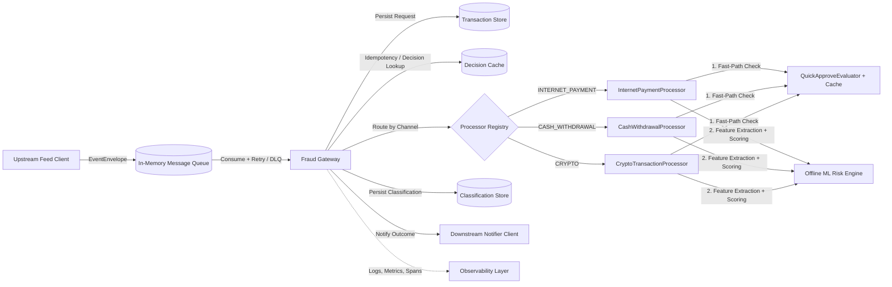

# Sentinel Fraud Detection Platform (TypeScript Monorepo Skeleton)

An **offline-first, strictly typed, event-driven TypeScript monorepo** implementing a real-time transaction fraud detection backend. Built around SOLID architecture, clean hexagonal boundaries, zero runtime network calls, and deterministic testability.

---

## Architecture Overview



## Monorepo Layout

| Workspace | Package Name | Responsibility |
| :--- | :--- | :--- |
| `packages/domain` | `@sentinel/domain` | Pure domain contracts, discriminated unions, errors, deterministic clock |
| `packages/observability` | `@sentinel/observability` | Structured logging, metrics, and distributed tracing ports + offline adapters |
| `packages/queue` | `@sentinel/queue` | Event bus, retry loop, and Dead-Letter Queue (DLQ) |
| `packages/storage` | `@sentinel/storage` | TTL cache, transaction repo, classification repo, quick-approve rule store |
| `packages/ml-engine` | `@sentinel/ml-engine` | Offline feature extractor and deterministic mock ML risk classifier |
| `packages/clients` | `@sentinel/clients` | Upstream transaction feed client and downstream notification client |
| `services/processors` | `@sentinel/processors` | Channel-specific processors (`INTERNET_PAYMENT`, `CASH_WITHDRAWAL`, `CRYPTO`) + quick-approve evaluator |
| `services/gateway` | `@sentinel/gateway` | Event consumer, `ProcessorRegistry`, orchestration pipeline, and DI composition root |
| `tests/` | — | Offline network guardrail, unit tests, and end-to-end pipeline tests |
| `roadmap.md` | — | **48 engineering tickets** (3–4 hours each for an AI programmer) to scale this skeleton to production grade |

## SOLID Design Principles Applied

- **Single Responsibility (SRP):** Routing (`FraudGateway`), channel evaluation (`*Processor`), fast-path trust rules (`QuickApproveEvaluator`), ML inference (`IRiskModel`), queueing (`IMessageQueue`), and persistence (`I*Repository`) live in isolated packages.
- **Open/Closed (OCP):** Adding a new channel (e.g., `WIRE_TRANSFER`) requires implementing `ITransactionProcessor` and registering it in `ProcessorRegistry`—zero modifications to `FraudGateway`.
- **Liskov Substitution (LSP):** All channel processors conform to `ITransactionProcessor<T>` and return consistent `ClassificationResult` contracts.
- **Interface Segregation (ISP):** Storage is split into focused ports (`ICache`, `ITransactionRepository`, `IClassificationRepository`, `IQuickApproveStore`) rather than one monolithic database client.
- **Dependency Inversion (DIP):** High-level services depend solely on interfaces; concrete offline adapters are wired exclusively in `services/gateway/src/bootstrap.ts`.

## Offline-Only Guarantee

This system makes **zero external network calls**. Every test run loads `tests/offline-guard.setup.ts`, which blocks `globalThis.fetch` and fails immediately on any outbound attempt. See Ticket `FD-001` and `FD-046` in `roadmap.md` for extending this to `node:http`, `node:https`, `node:net`, and `node:dns`.

## Quickstart

```bash
pnpm install
pnpm typecheck
pnpm test
pnpm test:unit
pnpm test:e2e
```

## Executing the Roadmap

Open [`roadmap.md`](./roadmap.md) at the repository root. It contains **48 sequential tickets** grouped into 8 epics. Each ticket includes acceptance criteria, a ready-to-paste AI programmer prompt (written in modern London English), and verification test commands.
